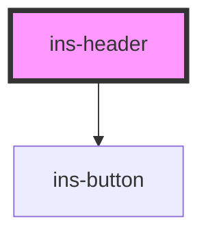

# ins-header

The admin top bar. Owns `toggleSidebar()`, which flips `body.mini` and calls the rail's
`minimise()`/`maximise()`; both `ins-sidebar-item` and the module's admin script call it, so its
contract is stable.

## Default rendering

Unchanged from the original: burger, fullscreen, optional support and notification buttons, and a
slot.

## v6 variant (IIA Admin Shell v1.5, opt-in)

`variant="v6"` renders the Admin Shell v1.5 top bar (TW#26371963): 56px `--ins-chrome-bg` on a
`1fr minmax(200px,480px) 1fr` grid (`auto 1fr` below 768px). Left: rail toggle and logo. Centre:
the support pill ("Ask us anything", presence dot, unread badge). Right: environment chip opening
the instance switcher, view-frontend, theme toggle, help menu and account menu. Only one header
popover is open at a time; Escape closes it; `[` toggles the rail; `?` opens the keyboard-shortcuts
dialog. The header draws every scrim inside itself, so it rises while one shows: to
`--iia-z-header-raised` for the switcher and account menu, above the page's fixed bars, and to
`--iia-z-modal` for the shortcuts dialog and the production warning, above the modules' drawers and
modals too (TW#26955888). Tooltips use the shared `data-tip` mechanism with the design's 150ms hover delay, instant
hide, and suppression once the trigger is clicked. Beneath the bar, a 40px breadcrumb bar follows
`ins-renderer`'s `insRouteChange` and hides on the dashboard.

Below 1280px the rail is a 64px column and an expanded rail is a drawer over the content. The header
keeps the desktop expanded/collapsed preference apart from the drawer: crossing into that range
collapses the rail, crossing back restores whatever the user last chose at desktop width, and toggles
made inside the range only open or close the drawer.

The theme toggle stamps `data-theme` on the document and the renderer iframe, then POSTs
`{ theme }` to `theme-endpoint` with the CSRF token from `meta[name=csrf-token]`, which is what the
previous hand-rolled header did. The switcher renders `instances` (JSON `[{id,name,env,domain}]`)
grouped Production then Staging with a check dot on `instance-id`; absent a roster it shows the
current instance alone, built from `instance-name`, `instance-domain` and `environment`. Switching
is presentational until Console exposes an instance list: choosing a production target opens the
confirmation, and confirming emits `insInstanceSwitch` without navigating.

```html
<ins-header variant="v6"
  logo-src="/assets/logo-white.svg"
  environment="staging" instance-name="Acme Staging" instance-domain="acme.staging-insites.io"
  user-name="Jane Doe" user-email="jane@acme.example"
  theme-endpoint="/insites/core/themes" lock-endpoint="/api/sessions">
</ins-header>
```

### Support chat (Intercom)

The support pill, and the icon button that replaces it below 768px, are the only way into Intercom
chat (TW#26801633). The instance boots Intercom with `hide_default_launcher: true`, so Intercom's
corner bubble never shows.

- A click opens the Messenger (`Intercom('show')`) and emits `insSupportOpen`. A click while the
  Messenger is open closes it (`Intercom('hide')`, no event). The header tracks the open state
  through `Intercom('onShow')` and `Intercom('onHide')`, so closing the Messenger from inside
  Intercom resets the toggle; `aria-expanded` follows it. The "Message support" rows in the help and
  account menus always open.
- The unread badge counts from `Intercom('onUnreadCountChange')`. The pill's screen reader label is
  "Open support chat, N unread messages".
- Intercom may load after the header (the host boots it asynchronously). The header subscribes once, on load, on
  the first support click or on the next minute tick, whichever finds `window.Intercom` first.

Availability follows office hours, because Intercom has no public live-presence API. Inside
`support-hours` the pill reads "Online" beside the green dot; outside them it reads
`support-reply-line` ("Replies in ~2h") and the dot goes muted (`iia-chat__dot--away`,
`iia-chat__presence--away`). The header checks on connect, every minute while connected (the timer
stops on disconnect), and whenever `support-hours` or `support-time-zone` changes.

| Attribute | Default | Meaning |
| --- | --- | --- |
| `support-hours` | `1-5 08:00-18:00` | ISO weekdays (1 = Monday to 7 = Sunday) as a range or comma list, a space, then `HH:MM-HH:MM` in 24-hour time. The end is exclusive: 18:00 reads the reply line. A day range may wrap (`6-1`). |
| `support-time-zone` | the browser's | IANA name the hours are in, e.g. `Australia/Melbourne`. |
| `support-reply-line` | `Replies in ~2h` | The label outside the hours. |
| `support-presence` | unset | A non-empty value pins the label and the online dot, whatever the time. Leave it unset to use the hours. |

An unreadable `support-hours` or an unknown `support-time-zone` logs one `console.warn` and falls
back to the default hours or the browser's zone.

```html
<ins-header variant="v6" support-hours="1-5 08:00-18:00" support-time-zone="Australia/Melbourne"></ins-header>
```

<!-- Auto Generated Below -->


## Overview

IIA v6 shell header (TW#26371963) is an ADDITIVE variant of this component.

`variant="v6"` renders the Admin Shell v1.5 top bar: 56px dark chrome carrying the
rail toggle, logo, the support pill, the environment chip with the instance
switcher, view-frontend, theme toggle, help menu and account menu, plus the 40px
breadcrumb bar beneath it, the keyboard-shortcuts dialog and the production
confirmation. The default render is unchanged. `toggleSidebar()` keeps its
contract because adminScripts and ins-sidebar-item both call it.

The instance switcher is presentational this release: the roster comes from
`instances` (JSON) or, absent that, the single current instance built from the
instance-* attributes. There is no Console endpoint that lists a user's
instances yet, so Switch emits `insInstanceSwitch` and navigates nowhere.

Tooltips use the shared `data-tip` mechanism rather than a nested component; the
design's 150ms delay / instant hide / suppress-after-click live in CSS on the
`iia-hdr` scope.

Support chat (TW#26801633): the support pill, and the icon button that replaces it below
768px, are the only way into Intercom (the instance boots Intercom with
`hide_default_launcher: true`). A click opens the Messenger and a click while it is open
closes it; the open state comes from Intercom's onShow/onHide. The pill reads "Online"
during `support-hours` in `support-time-zone` and `support-reply-line` otherwise, checked
every minute; a non-empty `support-presence` pins the label and the online dot instead.

## Properties

| Property              | Attribute               | Description                                                                                                                                                                                                            | Type      | Default                                     |
| --------------------- | ----------------------- | ---------------------------------------------------------------------------------------------------------------------------------------------------------------------------------------------------------------------- | --------- | ------------------------------------------- |
| `checkLoad`           | `check-load`            |                                                                                                                                                                                                                        | `boolean` | `false`                                     |
| `consoleHref`         | `console-href`          |                                                                                                                                                                                                                        | `string`  | `'https://console.insites.io/'`             |
| `docsHref`            | `docs-href`             |                                                                                                                                                                                                                        | `string`  | `'https://docs.insites.io/'`                |
| `environment`         | `environment`           | 'staging' \| 'production' — this instance's tier.                                                                                                                                                                      | `string`  | `'staging'`                                 |
| `frontendHref`        | `frontend-href`         |                                                                                                                                                                                                                        | `string`  | `'/'`                                       |
| `hasLoad`             | `has-load`              |                                                                                                                                                                                                                        | `string`  | `undefined`                                 |
| `hasMenuToggle`       | `has-menu-toggle`       |                                                                                                                                                                                                                        | `boolean` | `true`                                      |
| `helpPanelsDismissed` | `help-panels-dismissed` | Whether help panels are currently dismissed (restore row is actionable). Read from the preference store on load; a host may still set it.                                                                              | `boolean` | `false`                                     |
| `helpRestore`         | `help-restore`          | Show the "Show help panels" restore row in the account menu.                                                                                                                                                           | `boolean` | `true`                                      |
| `homeHref`            | `home-href`             |                                                                                                                                                                                                                        | `string`  | `'#/'`                                      |
| `instanceDomain`      | `instance-domain`       |                                                                                                                                                                                                                        | `string`  | `''`                                        |
| `instanceId`          | `instance-id`           |                                                                                                                                                                                                                        | `string`  | `'current'`                                 |
| `instanceName`        | `instance-name`         |                                                                                                                                                                                                                        | `string`  | `''`                                        |
| `instances`           | `instances`             | Optional JSON roster: [{ id, name, env, domain }]. Absent: the current instance alone.                                                                                                                                 | `string`  | `''`                                        |
| `load`                | `load`                  |                                                                                                                                                                                                                        | `boolean` | `false`                                     |
| `lockEndpoint`        | `lock-endpoint`         |                                                                                                                                                                                                                        | `string`  | `'/api/sessions'`                           |
| `lockFormName`        | `lock-form-name`        |                                                                                                                                                                                                                        | `string`  | `'modules/insites_core/lock_admin'`         |
| `logoAlt`             | `logo-alt`              |                                                                                                                                                                                                                        | `string`  | `'Insites'`                                 |
| `logoSrc`             | `logo-src`              |                                                                                                                                                                                                                        | `string`  | `''`                                        |
| `logoutHref`          | `logout-href`           |                                                                                                                                                                                                                        | `string`  | `'/admin/sessions/logout'`                  |
| `preferencesEndpoint` | `preferences-endpoint`  | Administrator-preferences endpoint: holds the dismissed help panels and the production-switch "Don't show me again" choice, per administrator, across devices.                                                         | `string`  | `'/insites/core/administrator-preferences'` |
| `profileHref`         | `profile-href`          |                                                                                                                                                                                                                        | `string`  | `'#/my-profile'`                            |
| `supportHours`        | `support-hours`         | Support office hours: ISO weekdays (1 = Monday to 7 = Sunday) as a range or comma list, a space, then HH:MM-HH:MM in 24-hour time with an exclusive end. An unreadable value warns once and falls back to the default. | `string`  | `DEFAULT_SUPPORT_HOURS`                     |
| `supportLink`         | `support-link`          |                                                                                                                                                                                                                        | `string`  | `undefined`                                 |
| `supportPresence`     | `support-presence`      | Presence label on the support pill. Leave it unset and the pill follows `support-hours` ("Online" inside them, `support-reply-line` outside). A non-empty value pins this label and the online dot whatever the time.  | `string`  | `undefined`                                 |
| `supportReplyLine`    | `support-reply-line`    | What the support pill reads outside `support-hours`, beside the away dot.                                                                                                                                              | `string`  | `'Replies in ~2h'`                          |
| `supportTimeZone`     | `support-time-zone`     | IANA time zone `support-hours` are in, e.g. "Australia/Melbourne". Empty: the browser's time zone. An unknown zone warns once and falls back to the browser's.                                                         | `string`  | `''`                                        |
| `themeEndpoint`       | `theme-endpoint`        |                                                                                                                                                                                                                        | `string`  | `'/insites/core/themes'`                    |
| `userEmail`           | `user-email`            |                                                                                                                                                                                                                        | `string`  | `''`                                        |
| `userName`            | `user-name`             |                                                                                                                                                                                                                        | `string`  | `''`                                        |
| `variant`             | `variant`               | '' keeps the original rendering. 'v6' is the Admin Shell v1.5 header.                                                                                                                                                  | `string`  | `''`                                        |


## Events

| Event               | Description | Type                                                      |
| ------------------- | ----------- | --------------------------------------------------------- |
| `didLoad`           |             | `CustomEvent<any>`                                        |
| `insHelpRestore`    |             | `CustomEvent<void>`                                       |
| `insInstanceSwitch` |             | `CustomEvent<{ from: string; to: string; env: string; }>` |
| `insLockScreen`     |             | `CustomEvent<void>`                                       |
| `insShortcutsOpen`  |             | `CustomEvent<void>`                                       |
| `insSupportOpen`    |             | `CustomEvent<void>`                                       |
| `insThemeChange`    |             | `CustomEvent<{ theme: string; }>`                         |


## Methods

### `lockScreen() => Promise<void>`

Locks the admin session: emits `insLockScreen`, ends the session through `lockEndpoint` and shows the
host's lock screen. The v1.5 design has no lock row, so the v6 chrome renders none; a host that keeps
the lock feature calls this method from its own trigger.

#### Returns

Type: `Promise<void>`


### `toggleNav() => Promise<void>`


#### Returns

Type: `Promise<void>`


### `toggleSidebar() => Promise<void>`


#### Returns

Type: `Promise<void>`


## Dependencies

### Depends on

- [ins-button](../ins-button)

### Graph


----------------------------------------------

*Built with [StencilJS](https://stenciljs.com/)*
