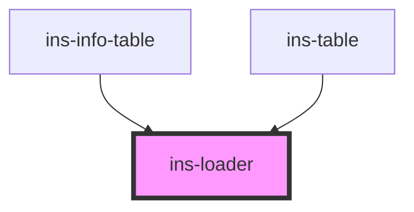

# ins-loader

<!-- Auto Generated Below -->

## Properties

| Property       | Attribute       | Description                                                                                                                                                                  | Type      | Default           |
| -------------- | --------------- | ---------------------------------------------------------------------------------------------------------------------------------------------------------------------------- | --------- | ----------------- |
| `checkLoad`    | `check-load`    |                                                                                                                                                                              | `boolean` | `false`           |
| `hasLoad`      | `has-load`      |                                                                                                                                                                              | `string`  | `undefined`       |
| `iconColor`    | `icon-color`    |                                                                                                                                                                              | `string`  | `""`              |
| `imageSource`  | `image-source`  | Loader image. Defaults to https://components.insites.io/assets/images/loading-loop-2x.gif; a root-relative /assets/ path is resolved against the module scripts' asset host. | `string`  | `FALLBACK_LOADER` |
| `load`         | `load`          |                                                                                                                                                                              | `boolean` | `false`           |
| `stateIcon`    | `state-icon`    |                                                                                                                                                                              | `string`  | `""`              |
| `stateMessage` | `state-message` |                                                                                                                                                                              | `string`  | `""`              |
| `stateTitle`   | `state-title`   |                                                                                                                                                                              | `string`  | `""`              |
| `useImage`     | `use-image`     |                                                                                                                                                                              | `boolean` | `true`            |

## Events

| Event     | Description | Type               |
| --------- | ----------- | ------------------ |
| `didLoad` |             | `CustomEvent<any>` |

## Dependencies

### Used by

 - [ins-info-table](../ins-info-table)
 - [ins-table](../ins-table)

### Graph

----------------------------------------------

*Built with [StencilJS](https://stenciljs.com/)*
